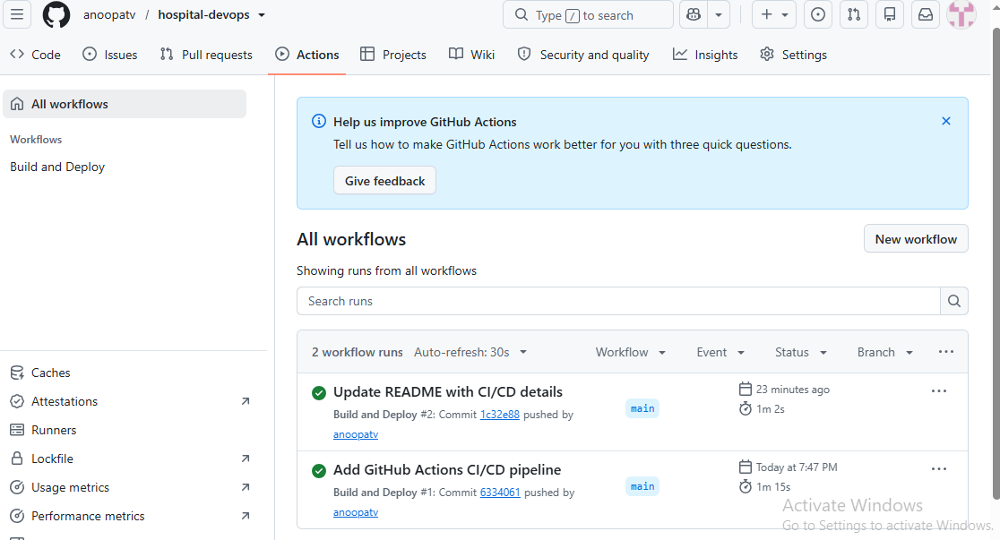
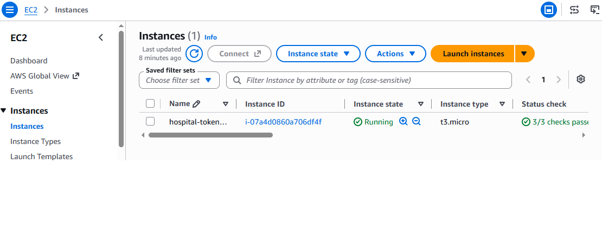
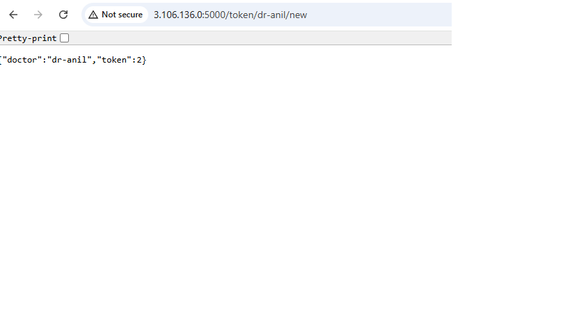
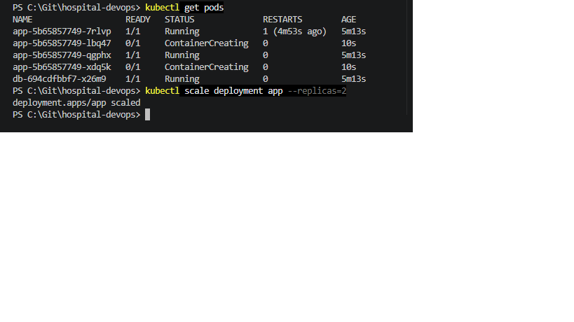

# Hospital Token System: DevOps Project

A simple hospital OP token system, built as a hands-on DevOps project. Each doctor has a separate token queue, like a real OP counter.

The focus of this project is the DevOps part: containerizing the app and deploying it on AWS with Infrastructure as Code and a CI/CD pipeline.

## Tech Stack

- Python (Flask)
- Docker
- PostgreSQL
- Docker Compose
- Terraform
- AWS (EC2, Security Groups)
- Amazon ECR
- GitHub Actions
- Kubernetes (Docker Desktop, local cluster)
- AWS Systems Manager (SSM)
- Git and GitHub

## API Endpoints

| Endpoint | What it does |
|---|---|
| `/` | Home page |
| `/token/<doctor>/new` | Generate a new token for a doctor |
| `/token/<doctor>/list` | List all tokens of a doctor |
| `/health` | Health check |

Doctors available: `dr-anil`, `dr-meera`, `dr-suresh`

## Run with Docker

```
docker compose up --build
```

Then open `http://localhost:5000/token/dr-anil/new` in the browser.

## How It Works

1. Code is pushed to the `main` branch on GitHub.
2. GitHub Actions builds the Docker image and pushes it to Amazon ECR.
3. GitHub Actions uses AWS SSM to run the deployment on the EC2 server.
4. The EC2 server pulls the new image and runs the app with a PostgreSQL container.

The AWS infrastructure (EC2, Security Group, ECR, IAM role) is created with Terraform.

## Screenshots

**CI/CD pipeline (GitHub Actions)**



**EC2 server created with Terraform**



**App running on AWS**



**Kubernetes pods running locally**



## Project Progress

- [x] Flask app
- [x] Dockerfile
- [x] PostgreSQL database with docker-compose
- [x] AWS infrastructure with Terraform
- [x] Kubernetes deployment
- [x] CI/CD pipeline with GitHub Actions
- [ ] Monitoring with Prometheus and Grafana